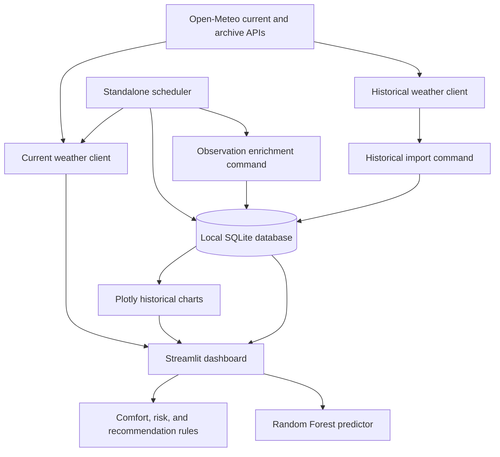

# Intelligent Weather Data Logger

A Python and Streamlit project that retrieves current and daily historical weather from Open-Meteo, stores imported or scheduled observations in SQLite, and presents rule-based weather analysis alongside a trained comfort-category classifier.

## Overview

Weather applications often show measurements without translating them into comfort, risk, or practical guidance. This project combines weather retrieval, local persistence, deterministic analysis, and a scikit-learn model. The dashboard can fetch current weather on demand for a fixed set of cities. Separate command-line utilities import historical observations, enrich stored records, train the classifier, and run periodic collection.

The dashboard's on-demand current weather request is displayed and analyzed immediately; that path does not save the observation. Historical charts and database summaries read records stored by the separate importer or scheduler workflows.

## Key Features

- Retrieve current temperature, relative humidity, mean sea-level pressure, wind speed, precipitation, and timestamp from Open-Meteo.
- Import daily historical mean temperature, precipitation sum, and maximum wind speed for six configured Indian cities; humidity and pressure are set to fixed defaults for those historical rows.
- Store locations, weather observations, and optional prediction records in SQLite.
- Calculate a deterministic comfort score and category, rule-based risk levels, and text recommendations.
- Flag temperature deviations using a fixed 28°C comparison baseline in the enrichment pipeline.
- Train and load a Random Forest comfort-category classifier using temperature, humidity, and wind speed.
- Display current conditions, analysis, model prediction, historical charts, and local database totals in a Streamlit dashboard.
- Run an optional standalone process that collects weather on startup and then at a configured interval.

## System Architecture



The diagram shows separate paths: the dashboard's current-weather button does not persist its response, while the importer and scheduler write observations to SQLite. The schema is created when the dashboard starts or by running the schema module directly.

## Technical Workflow

### Dashboard current-weather path

1. Choose one of Bengaluru, Mumbai, Chennai, Delhi, Hyderabad, or Kolkata.
2. On button click, request current measurements from Open-Meteo.
3. Check coordinates and required response fields, then convert measurements to numeric values.
4. Display the measurements and calculate comfort, risks, recommendations, and a model prediction in memory.

### Stored-observation path

1. Run the historical importer for daily data from the six hard-coded cities and date range, or start the separate scheduler for current observations at the configured default location.
2. Insert locations and observations into SQLite; repeated location/timestamp pairs are skipped by the importer and scheduler.
3. The scheduler runs the enrichment pipeline after inserting an observation. For historical imports, run the enrichment command separately to populate the derived fields.
4. The dashboard reads stored records for chart and summary sections.

## Analytics Engine

### Comfort Analysis

The deterministic score starts at 100. It subtracts 3 points per °C outside 20–26°C, 0.6 points per humidity percentage point outside 30–60%, and 1.2 points per km/h above 15 km/h. The wind lower bound is 0 km/h. The result is clamped to 0–100 and rounded to two decimal places. Categories are Excellent (90+), Good (75+), Moderate (60+), Poor (40+), and Extreme (below 40).

### Anomaly Detection

The anomaly utility returns the absolute difference between a value and a supplied comparison value; its default flag threshold is strictly greater than 10. The database enrichment pipeline compares temperature against a fixed 28°C baseline. This is not a location-specific or dynamically calculated historical average. The dashboard's live request does not run or display this anomaly check.

### Risk Assessment

- Heat stress is High at temperature ≥35°C, or at ≥32°C with humidity ≥70%; Moderate at temperature ≥28°C or humidity ≥65%; otherwise Low.
- Dehydration is High at ≥35°C, Moderate from 28°C through 34°C, and otherwise Low. Humidity is not used in this rule.
- Outdoor activity is Unsafe above 40°C, 20 mm precipitation, or 40 km/h wind; Caution above 32°C, 5 mm, or 25 km/h; otherwise Safe.

These are project heuristics, not medical guidance.

### Recommendation Engine

Hydration text follows the dehydration risk label; clothing text uses temperature thresholds of 25°C and 35°C; activity text follows the outdoor activity risk label. The dashboard shows all three recommendations after a successful current-weather fetch.

## Machine Learning Pipeline

`scripts/populate_training_data.py` computes `comfort_category` labels with the deterministic comfort rules for stored rows with no comfort score. `ml/train_model.py` trains a `RandomForestClassifier` with 100 trees and `random_state=42`, using temperature, humidity, and wind speed as features. A `LabelEncoder` encodes the target category. Training uses a stratified 80/20 split with `random_state=42`; it prints a classification report and saves the model and encoder as Joblib files.

The trainer requires at least 20 labeled rows and at least 10 examples in every class. The dashboard loads the checked-in model and encoder, predicts a category for the current measurements, and displays the largest `predict_proba` value as prediction confidence. This confidence is not a measure of held-out model accuracy. The app does not persist these live predictions to `ml_predictions`.

To retrain from local data, first initialize and populate the database, then run:

```bash
python -m scripts.populate_training_data
python -m ml.train_model
```

## Data Storage

SQLite is stored at `data/weather.db` by default. The dashboard creates its schema on startup; alternatively run `python -m database.schema`. The database file is local and ignored by Git.

| Table | Purpose |
| --- | --- |
| `locations` | Unique coordinates with a city name. |
| `weather_observations` | Timestamp, source, measurements, comfort/anomaly/risk fields, and recommendation text. |
| `ml_predictions` | Schema for prediction category, timestamp, and confidence; current application paths do not insert rows here. |

See [DATABASE_DESIGN.md](DATABASE_DESIGN.md) and [DATA_DICTIONARY.md](DATA_DICTIONARY.md) for field details.

## Data Source

Current observations use the Open-Meteo Forecast API; daily historical observations use the Open-Meteo Archive API. The clients make unauthenticated requests and no API key is configured. Historical rows use fixed humidity (50%) and pressure (1013 hPa) defaults because the archive request only asks for daily mean temperature, precipitation sum, and maximum wind speed.

## Dashboard

The single Streamlit dashboard has a location selector and “Fetch Current Weather” button, then sections for current measurements, comfort analysis, risk assessment, recommendations, an ML prediction, historical temperature and comfort charts, category and risk distributions, and database totals. Current weather and its analysis appear only after the user requests a fetch. Historical charts depend on stored observations and may be empty in a fresh database.

## Project Structure

```text
.
├── analytics/          Comfort, anomaly, risk, and recommendation rules
├── api/                Open-Meteo current and historical clients
├── app/                Streamlit dashboard
├── config/             YAML configuration and settings loader
├── database/           SQLite schema and data access
├── logs/               Application logger
├── ml/                 Predictor, trainer, and required model artifacts
├── processing/         Empty package placeholder
├── scheduler/          Standalone periodic weather collector
├── scripts/            Historical import and observation enrichment
├── tests/              Unit tests for analytics engines
├── visualizations/     SQLite-backed Plotly charts
├── requirements*.txt   Runtime and test dependencies
└── *.md                README and project/technical documentation
```

## Installation

Use Python 3.11 or newer. Dependencies are pinned in `requirements.txt`.

### Windows PowerShell

```powershell
git clone https://github.com/xenkai800-droid/intelligent-weather-data-logger.git
cd intelligent-weather-data-logger
py -3 -m venv .venv
.venv\Scripts\Activate.ps1
python -m pip install -r requirements.txt
```

### macOS / Linux

```bash
git clone https://github.com/xenkai800-droid/intelligent-weather-data-logger.git
cd intelligent-weather-data-logger
python3 -m venv .venv
source .venv/bin/activate
python -m pip install -r requirements.txt
```

## Running the Application

```bash
streamlit run app/dashboard.py
```

The dashboard creates the SQLite database and tables if absent. Live weather retrieval requires network access.

To import the configured historical range (2024-01-01 through 2025-12-31) for all six cities, initialize the schema first if needed and run:

```bash
python -m database.schema
python -m scripts.import_historical_data
python -m scripts.populate_training_data
```

The date range and city list are constants in the importer. This command can make many API requests and is separate from starting the dashboard.

To run the periodic collector as its own foreground process:

```bash
python -m database.schema
python -m scheduler.weather_scheduler
```

It collects once immediately and then uses `scheduler.interval_minutes` from the configuration. Stop it with Ctrl+C. `scheduler.enabled` is exposed by settings but is not checked by this scheduler.

## Running Tests

Install the test dependency and run the analytics unit tests:

```bash
python -m pip install -r requirements-dev.txt
pytest
```

The current suite covers the comfort, anomaly, risk, and recommendation engines. It does not test the API clients, database workflows, scheduler, model training, or dashboard.

## Configuration

`config/config.yaml` contains the default database path, Open-Meteo timeout setting, scheduler location and interval, historical date values, model paths, and logging settings. `config/settings.py` loads and validates required YAML sections and provides typed accessors. The active API clients use their own hard-coded timeout values; the historical importer uses hard-coded dates and city coordinates; the dashboard uses its own database and model path constants. These YAML values do not override those code-level constants today.

## Limitations

- The dashboard only offers six predefined locations.
- The current-weather button does not persist fetched data; use the separate scheduler to collect current observations.
- Historical humidity and pressure are placeholders, not archive measurements.
- Anomaly comparison uses a fixed 28°C baseline rather than a location-specific time series.
- The risk and recommendation rules are simple heuristics.
- Training labels are generated by the same comfort rules that define the comfort categories. The training report is a random holdout evaluation of those labels; no independent labels or ongoing model monitoring are provided.
- SQLite is local storage, and historical charts remain empty until stored data has been imported or collected and enriched.

## Future Improvements

Potential follow-up work includes accepting arbitrary coordinates, persisting dashboard fetches and predictions, deriving anomaly baselines from stored history, using measured humidity and pressure in historical records, adding integration tests, and evaluating the classifier against independent observations.

## License

No license file is currently included.
